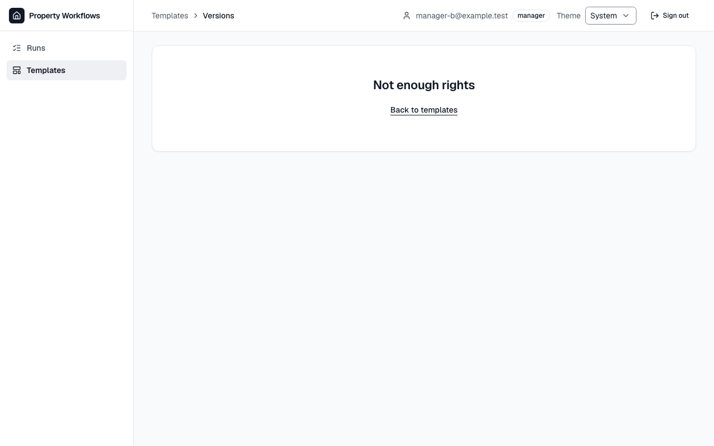
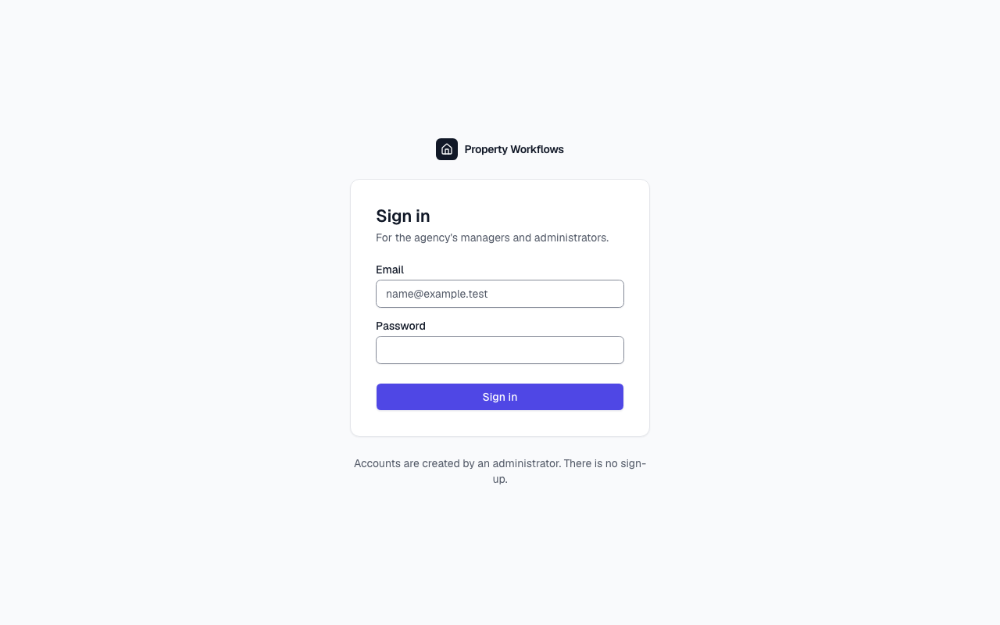
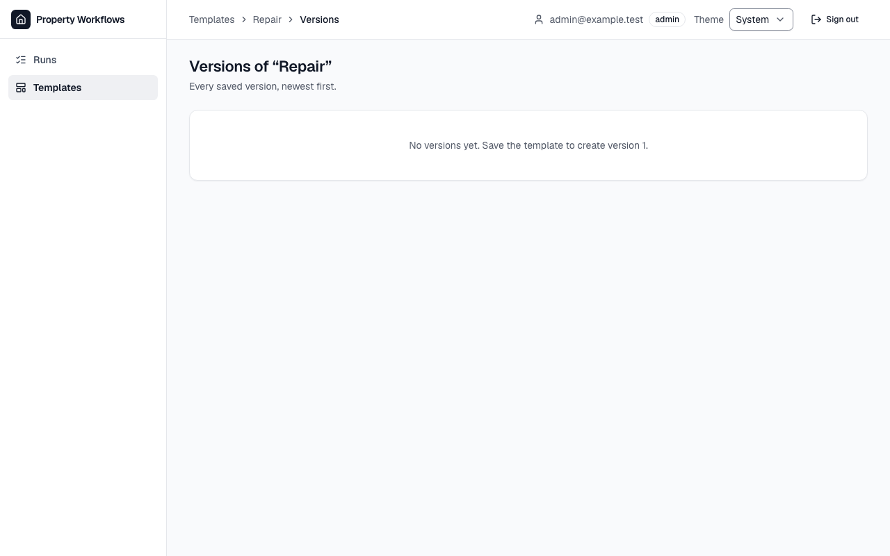

# Звіт UAT — 31.10.2026

- **Застосунок:** https://property-workflows.vercel.app (/api/health: коміт `5cc1f43`)
- **Код тестів:** `task/uat` @ `7911a19` + незакомічені зміни
- **Прогін:** 31.10.2026, 14:02 (Київ), Playwright 29.8 с; AC: 3 — PASS 3, FAIL 0, NEEDS-HUMAN 0
- **Рецензент:** `claude-haiku-5-5`; суперечки → `claude-sonnet-5-5`. Разом за розбір: $0.0053 (ціни API; за підпискою — у межах ліміту плану)
- **Прибирання:** синтетичних uat-*@example.test видалено 0, лишилось 0, їхніх рядків, що лишились: 0
- **Відео й траси:** не в git — `test-results/` локально або артефакт CI; трасу відкриває `npx playwright show-trace <trace.zip>`

| AC | Перевірки | Агент | Підсумок | Чому | Playwright | Розбір |
|---|---|---|---|---|---|---|
| AC-EDITOR-07 | пройшли | Haiku: PASS | **PASS** | R6: перевірки, агент і цитати збігаються | 7.9 с | $0.0017, 6.2 с |
| AC-EDITOR-09 | пройшли | Haiku: PASS | **PASS** | R6: перевірки, агент і цитати збігаються | 6.0 с | $0.0018, 6.7 с |
| AC-EDITOR-18 | пройшли | Haiku: PASS | **PASS** | R6: перевірки, агент і цитати збігаються | 4.9 с | $0.0019, 7.0 с |

## AC-EDITOR-07 — PASS

**Тест:** AC-EDITOR-07: менеджер B за прямим посиланням на версії «Tenant move-in» бачить «Not enough rights» і жодної версії

**Критерій** (requirements/20-edit-template-version-control.md):

> AC-EDITOR-07: Given manager B signed in and the template "Tenant move-in" with versions 1 and 2. When B opens the list of versions of this template by a direct link. Then B sees the message "Not enough rights" and no versions.

**Кроки:** ✔ Дано: manager B signed in and the template "Tenant move-in" with versions 1 and 2 → ✔ Коли: B opens the list of versions of this template by a direct link → ✔ Тоді: B sees the message "Not enough rights" and no versions.

**Агент (claude-haiku-5-5, PASS):** На кадрі frame-then-1.png видно великий заголовок «Not enough rights» у центральній картці сторінки версій шаблону, з посиланням «Back to templates». Текст повністю збігається з критерієм, регістр і пунктуація також. Частина «no versions» не з кадрів, тому я її не оцінював.

**Цитати агента, звірені зі сторінкою (aria):**
- «Not enough rights» — є на сторінці

**Правило:** R6: перевірки, агент і цитати збігаються

**Відео:** `test-results/artifacts/template-versions-менеджер-865b7-ugh-rights»-і-жодної-версії-chromium/video.webm` · **траса:** `test-results/artifacts/template-versions-менеджер-865b7-ugh-rights»-і-жодної-версії-chromium/trace.zip` (не в git)

**Рішення PM:** ☐ приймаю · ☐ відхилення від вимог (issue «Відхилення від вимог: AC-EDITOR-07 — …») · @login: ____

## AC-EDITOR-09 — PASS

**Тест:** AC-EDITOR-09: відвідувач без входу за прямим посиланням на редактор «Tenant move-in» бачить сторінку входу без вмісту шаблону

**Критерій** (requirements/20-edit-template-version-control.md):

> AC-EDITOR-09: Given a visitor who is not signed in. When the visitor opens the editor of the template "Tenant move-in" by a direct link. Then the visitor sees the sign-in page and no content of the template.

**Кроки:** ✔ Дано: a visitor who is not signed in → ✔ Коли: the visitor opens the editor of the template "Tenant move-in" by a direct link → ✔ Тоді: the visitor sees the sign-in page and no content of the template.

**Агент (claude-haiku-5-5, PASS):** На кадрі frame-then-1.png видно сторінку входу «Property Workflows» із заголовком «Sign in», полями «Email» і «Password» та кнопкою «Sign in», без жодного вмісту шаблону. Вимога про відсутність вмісту шаблону та адресу /login не оцінюється з кадрів; адресу рядка браузера на кадрі не видно.

**Цитати агента, звірені зі сторінкою (aria):**
- «Sign in» — є на сторінці
- «Email» — є на сторінці
- «Password» — є на сторінці
- «Sign in» — є на сторінці

**Правило:** R6: перевірки, агент і цитати збігаються

**Відео:** `test-results/artifacts/editor-access-AC-EDITOR-09-2033a-ку-входу-без-вмісту-шаблону-chromium/video.webm` · **траса:** `test-results/artifacts/editor-access-AC-EDITOR-09-2033a-ку-входу-без-вмісту-шаблону-chromium/trace.zip` (не в git)

**Рішення PM:** ☐ приймаю · ☐ відхилення від вимог (issue «Відхилення від вимог: AC-EDITOR-09 — …») · @login: ____

## AC-EDITOR-18 — PASS

**Тест:** AC-EDITOR-18: адміністратор A відкриває версії нового шаблону «Repair» — «No versions yet. Save the template to create version 1.» і без порожньої таблиці

**Критерій** (requirements/20-edit-template-version-control.md):

> AC-EDITOR-18: Given administrator A and the new template "Repair" that has never been saved as a version. When A opens the list of versions of "Repair". Then A sees the message "No versions yet. Save the template to create version 1." and no empty table.

**Кроки:** ✔ Дано: administrator A and the new template "Repair" that has never been saved as a version → ✔ Коли: A opens the list of versions of "Repair" → ✔ Тоді: A sees the message "No versions yet. Save the template to create version 1." and no empty table.

**Агент (claude-haiku-5-5, PASS):** На кадрі сторінки «Versions of “Repair”» текст у картці дослівно збігається з критерієм: «No versions yet. Save the template to create version 1.». Таблиці з заголовками на кадрі не видно, але відсутність таблиці за правилами не оцінюється з кадрів, тож позначено як cannot-tell.

**Цитати агента, звірені зі сторінкою (aria):**
- «No versions yet. Save the template to create version 1.» — є на сторінці

**Правило:** R6: перевірки, агент і цитати збігаються

**Відео:** `test-results/artifacts/template-versions-адмініст-27669-1-»-і-без-порожньої-таблиці-chromium/video.webm` · **траса:** `test-results/artifacts/template-versions-адмініст-27669-1-»-і-без-порожньої-таблиці-chromium/trace.zip` (не в git)

**Рішення PM:** ☐ приймаю · ☐ відхилення від вимог (issue «Відхилення від вимог: AC-EDITOR-18 — …») · @login: ____

## Як читати підсумок

- **PASS** — автоматичні перевірки пройшли, агент-рецензент погодився з кадром, а кожну його цитату знайдено на сторінці.
- **FAIL** — впала автоматична перевірка. Агент цього не перекриває: невидимі вади (буфер обміну, база) він на кадрі не побачить.
- **NEEDS-HUMAN** — перевірки зелені, але агент не погодився або його цитати немає на сторінці. Часто це слабкий тест або розбіжність між текстом AC і тестом — питання до PM, а не обов'язково вада продукту.

Правила: R1: перевірка впала — FAIL завжди, агент не перекриває; R2: немає вердикту агента або кадру; R3: перевірки пройшли, агент не погоджується — вирішує людина; R4: цитати агента немає на сторінці (aria) — не підтверджено; R5: помилка сторінки або 5xx під час сценарію; R6: перевірки, агент і цитати збігаються.
