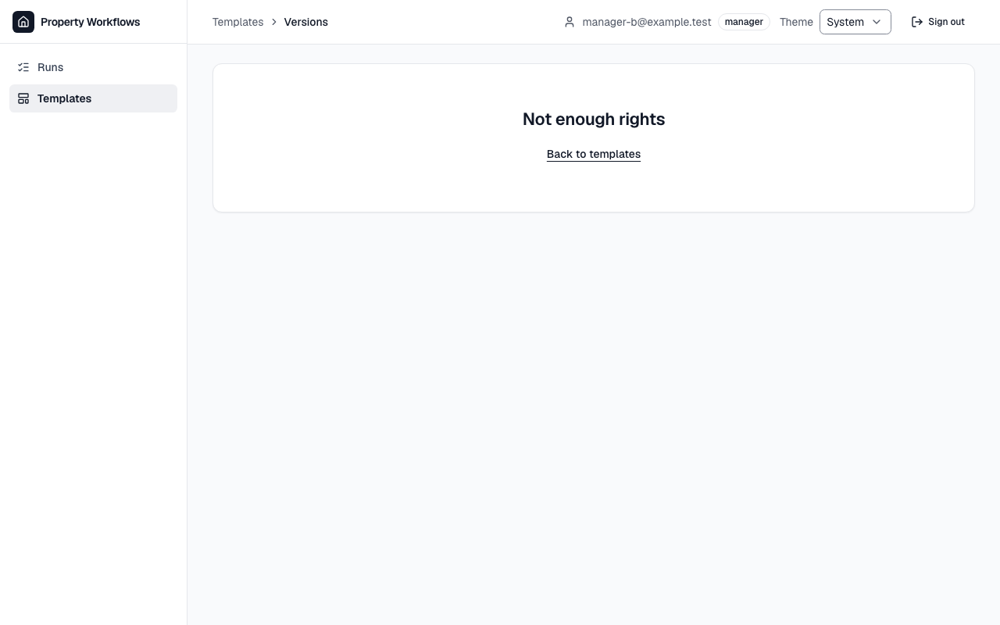
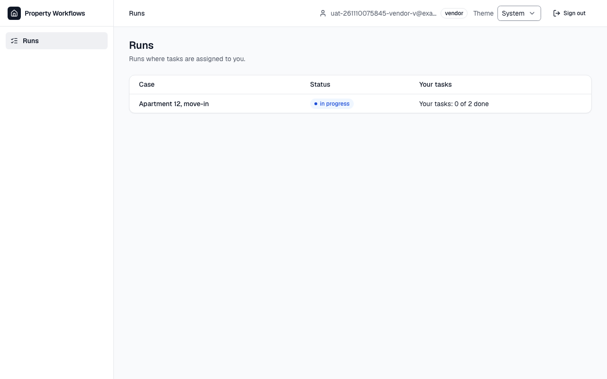

# Звіт UAT — 10.11.2026

- **Застосунок:** https://property-workflows.vercel.app (/api/health: коміт `4eb4705`)
- **Код тестів:** `main` @ `4eb4705` + незакомічені зміни (лише щойно створений і ще не закомічений звіт `docs/qa/uat/2026-11-10/`; код тестів — `4eb4705`)
- **Прогін:** 10.11.2026, 09:58 (Київ), Playwright 46.6 с; AC: 0 — PASS 0, FAIL 0, NEEDS-HUMAN 0; негативних контролів: 2
- **Рецензент:** `claude-haiku-5-5`; суперечки → `claude-sonnet-5-5`. Разом за розбір: $0.0035 (ціни API; за підпискою — у межах ліміту плану)
- **Прибирання:** синтетичних uat-*@example.test видалено 5, лишилось 0, їхніх рядків, що лишились: 0
- **Відео й траси:** не в git — `test-results/` локально або артефакт CI; трасу відкриває `npx playwright show-trace <trace.zip>`

| AC | Перевірки | Агент | Підсумок | Чому | Playwright | Розбір |
|---|---|---|---|---|---|---|
| NC-1 (AC-EDITOR-07) | впали | Haiku: PASS | **FAIL** | R1: перевірка впала — FAIL завжди, агент не перекриває | 11.9 с | $0.0017, 6.4 с |
| NC-2 (AC-VENDOR-03) | впали | Haiku: PASS | **FAIL** | R1: перевірка впала — FAIL завжди, агент не перекриває | 10.4 с | $0.0018, 6.2 с |

## NC-1 — негативний контроль для AC-EDITOR-07 — FAIL

**Тест:** NC-1 (AC-EDITOR-07, навмисно хибне очікування в тесті: інший текст повідомлення)

**Критерій** (requirements/20-edit-template-version-control.md):

> AC-EDITOR-07: Given manager B signed in and the template "Tenant move-in" with versions 1 and 2. When B opens the list of versions of this template by a direct link. Then B sees the message "Not enough rights" and no versions.



**Кроки:** ✔ Дано: manager B signed in and the template "Tenant move-in" with versions 1 and 2 → ✔ Коли: B opens the list of versions of this template by a direct link → ✘ Тоді: B sees the message "Not enough rights" and no versions.

**Перевірка впала:**

```
Error: expect(locator).toHaveText(expected) failed

Locator:  getByRole('main').getByRole('heading', { level: 1 })
Expected: "Access denied"
Received: "Not enough rights"
Timeout:  5000ms

Call log:
```

**Агент (claude-haiku-5-5, PASS):** На кадрі сторінки /templates/.../versions під заголовком видно великий напис «Not enough rights», під ним посилання «Back to templates». Список версій на кадрі відсутній, тобто видно лише повідомлення про відмову, без версій. Частина «and no versions» не входить до переліку видимих частин, тому оцінено лише повідомлення.

**Цитати агента, звірені зі сторінкою (aria):**
- «Not enough rights» — є на сторінці

**Правило:** R1: перевірка впала — FAIL завжди, агент не перекриває

**Відео:** `test-results/artifacts/negative-controls-NC-1-AC--f67a3-і-інший-текст-повідомлення--negative-controls/video.webm` · **траса:** `test-results/artifacts/negative-controls-NC-1-AC--f67a3-і-інший-текст-повідомлення--negative-controls/trace.zip` (не в git)

_Негативний контроль: навмисно хибне очікування. Очікуваний підсумок — FAIL або NEEDS-HUMAN, не PASS._

## NC-2 — негативний контроль для AC-VENDOR-03 — FAIL

**Тест:** NC-2 (AC-VENDOR-03, навмисно хибне очікування в тесті: інший лічильник «Your tasks»)

**Критерій** (requirements/39-assign-vendor-own-tasks.md):

> AC-VENDOR-03: Given vendor V who is the assignee of 2 tasks in the run "Apartment 12, move-in" and of no task in the run "Apartment 14, repair". When V opens the list of runs. Then V sees only the run "Apartment 12, move-in" with its run status and "Your tasks: 0 of 2 done", and does not see "Apartment 14, repair".



**Кроки:** ✔ Дано: vendor V who is the assignee of 2 tasks in the run "Apartment 12, move-in" → ✔ Коли: V opens the list of runs → ✘ Тоді: V sees only the run "Apartment 12, move-in" with its run status and "Your tasks: 0 of 2 done", and does not see "Apartment 14, repair".

**Перевірка впала:**

```
Error: expect(locator).toHaveText(expected) failed

Locator:  getByTestId('vendor-run').first().getByTestId('your-tasks')
Expected: "Your tasks: 2 of 2 done"
Received: "Your tasks: 0 of 2 done"
Timeout:  5000ms

Call log:
```

**Агент (claude-haiku-5-5, PASS):** На кадрі сторінки «Runs» у таблиці є один рядок: «Apartment 12, move-in», статус «in progress», «Your tasks: 0 of 2 done». Рядка «Apartment 14, repair» на кадрі немає, що відповідає вимозі не показувати цей запуск. Частина «Your tasks: 0 of 2 done» збігається посимвольно.

**Цитати агента, звірені зі сторінкою (aria):**
- «Your tasks: 0 of 2 done» — є на сторінці

**Правило:** R1: перевірка впала — FAIL завжди, агент не перекриває

**Відео:** `test-results/artifacts/negative-controls-вендор-V-fb73b-ший-лічильник-«Your-tasks»--negative-controls/video.webm` · **траса:** `test-results/artifacts/negative-controls-вендор-V-fb73b-ший-лічильник-«Your-tasks»--negative-controls/trace.zip` (не в git)

_Негативний контроль: навмисно хибне очікування. Очікуваний підсумок — FAIL або NEEDS-HUMAN, не PASS._

## Як читати підсумок

- **PASS** — автоматичні перевірки пройшли, агент-рецензент погодився з кадром, а кожну його цитату знайдено на сторінці.
- **FAIL** — впала автоматична перевірка. Агент цього не перекриває: невидимі вади (буфер обміну, база) він на кадрі не побачить.
- **NEEDS-HUMAN** — перевірки зелені, але агент не погодився або його цитати немає на сторінці. Часто це слабкий тест або розбіжність між текстом AC і тестом — питання до PM, а не обов'язково вада продукту.

Правила: R1: перевірка впала — FAIL завжди, агент не перекриває; R2: немає вердикту агента або кадру; R3: перевірки пройшли, агент не погоджується — вирішує людина; R4: цитати агента немає на сторінці (aria) — не підтверджено; R5: помилка сторінки або 5xx під час сценарію; R6: перевірки, агент і цитати збігаються.
