# Звіт UAT — 10.11.2026

- **Застосунок:** https://property-workflows.vercel.app (/api/health: коміт `4eb4705`)
- **Код тестів:** `task/uat-report-vendor` @ `dcde450`
- **Прогін:** 10.11.2026, 10:06 (Київ), Playwright 97.2 с; AC: 13 — PASS 11, FAIL 0, NEEDS-HUMAN 2
- **Рецензент:** `claude-haiku-5-5`; суперечки → `claude-sonnet-5-5`. Разом за розбір: $0.0924 (ціни API; за підпискою — у межах ліміту плану)
- **Прибирання:** синтетичних uat-*@example.test видалено 5, лишилось 0, їхніх рядків, що лишились: 0
- **Відео й траси:** не в git — `test-results/` локально або артефакт CI; трасу відкриває `npx playwright show-trace <trace.zip>`

| AC | Перевірки | Агент | Підсумок | Чому | Playwright | Розбір |
|---|---|---|---|---|---|---|
| AC-EDITOR-07 | пройшли | Haiku: PASS | **PASS** | R6: перевірки, агент і цитати збігаються | 6.6 с | $0.0018, 6.7 с |
| AC-EDITOR-09 | пройшли | Haiku: PASS | **PASS** | R6: перевірки, агент і цитати збігаються | 5.2 с | $0.0019, 7.5 с |
| AC-EDITOR-18 | пройшли | Haiku: PASS | **PASS** | R6: перевірки, агент і цитати збігаються | 4.3 с | $0.0018, 6.7 с |
| AC-VENDOR-01 | пройшли | Haiku: NEEDS-HUMAN, Sonnet: NEEDS-HUMAN | **NEEDS-HUMAN** | R3: перевірки пройшли, агент не погоджується — вирішує людина | 12.4 с | $0.0365, 21.5 с |
| AC-VENDOR-02 | пройшли | Haiku: NEEDS-HUMAN, Sonnet: NEEDS-HUMAN | **NEEDS-HUMAN** | R3: перевірки пройшли, агент не погоджується — вирішує людина | 3.8 с | $0.0356, 21.8 с |
| AC-VENDOR-03 | пройшли | Haiku: PASS | **PASS** | R6: перевірки, агент і цитати збігаються | 5.2 с | $0.0019, 6.4 с |
| AC-VENDOR-04 | пройшли | Haiku: PASS | **PASS** | R6: перевірки, агент і цитати збігаються | 4.6 с | $0.0021, 8.6 с |
| AC-VENDOR-05 | пройшли | Haiku: PASS | **PASS** | R6: перевірки, агент і цитати збігаються | 7.4 с | $0.0021, 10.3 с |
| AC-VENDOR-06 | пройшли | Haiku: PASS | **PASS** | R6: перевірки, агент і цитати збігаються | 4.7 с | $0.0017, 5.6 с |
| AC-VENDOR-07 | пройшли | Haiku: PASS | **PASS** | R6: перевірки, агент і цитати збігаються | 3.0 с | $0.0018, 6.2 с |
| AC-VENDOR-08 | пройшли | Haiku: PASS | **PASS** | R6: перевірки, агент і цитати збігаються | 4.7 с | $0.0016, 6.3 с |
| AC-VENDOR-09 | пройшли | Haiku: PASS | **PASS** | R6: перевірки, агент і цитати збігаються | 3.7 с | $0.0019, 7.9 с |
| AC-VENDOR-10 | пройшли | Haiku: PASS | **PASS** | R6: перевірки, агент і цитати збігаються | 2.1 с | $0.0018, 5.8 с |

## AC-EDITOR-07 — PASS

**Тест:** AC-EDITOR-07: менеджер B за прямим посиланням на версії «Tenant move-in» бачить «Not enough rights» і жодної версії

**Критерій** (requirements/20-edit-template-version-control.md):

> AC-EDITOR-07: Given manager B signed in and the template "Tenant move-in" with versions 1 and 2. When B opens the list of versions of this template by a direct link. Then B sees the message "Not enough rights" and no versions.

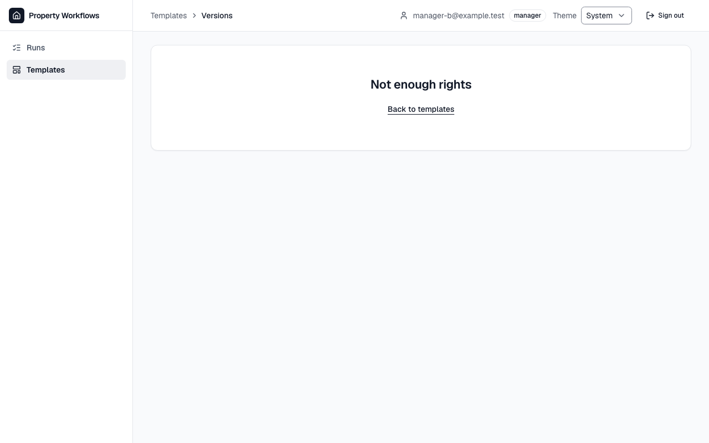

**Кроки:** ✔ Дано: manager B signed in and the template "Tenant move-in" with versions 1 and 2 → ✔ Коли: B opens the list of versions of this template by a direct link → ✔ Тоді: B sees the message "Not enough rights" and no versions.

**Агент (claude-haiku-5-5, PASS):** На кадрі frame-then-1.png сторінка /templates/…/versions показує заголовок «Not enough rights» і посилання «Back to templates»; таблиці версій чи рядків версій на кадрі немає. Заголовок збігається з критерієм посимвольно. Частину «no versions» за правилами не оцінюю, бо вона перевіряється автоматично.

**Цитати агента, звірені зі сторінкою (aria):**
- «Not enough rights» — є на сторінці

**Правило:** R6: перевірки, агент і цитати збігаються

**Відео:** `test-results/artifacts/template-versions-менеджер-865b7-ugh-rights»-і-жодної-версії-chromium/video.webm` · **траса:** `test-results/artifacts/template-versions-менеджер-865b7-ugh-rights»-і-жодної-версії-chromium/trace.zip` (не в git)

**Рішення PM:** ☐ приймаю · ☐ відхилення від вимог (issue «Відхилення від вимог: AC-EDITOR-07 — …») · @login: ____

## AC-EDITOR-09 — PASS

**Тест:** AC-EDITOR-09: відвідувач без входу за прямим посиланням на редактор «Tenant move-in» бачить сторінку входу без вмісту шаблону

**Критерій** (requirements/20-edit-template-version-control.md):

> AC-EDITOR-09: Given a visitor who is not signed in. When the visitor opens the editor of the template "Tenant move-in" by a direct link. Then the visitor sees the sign-in page and no content of the template.

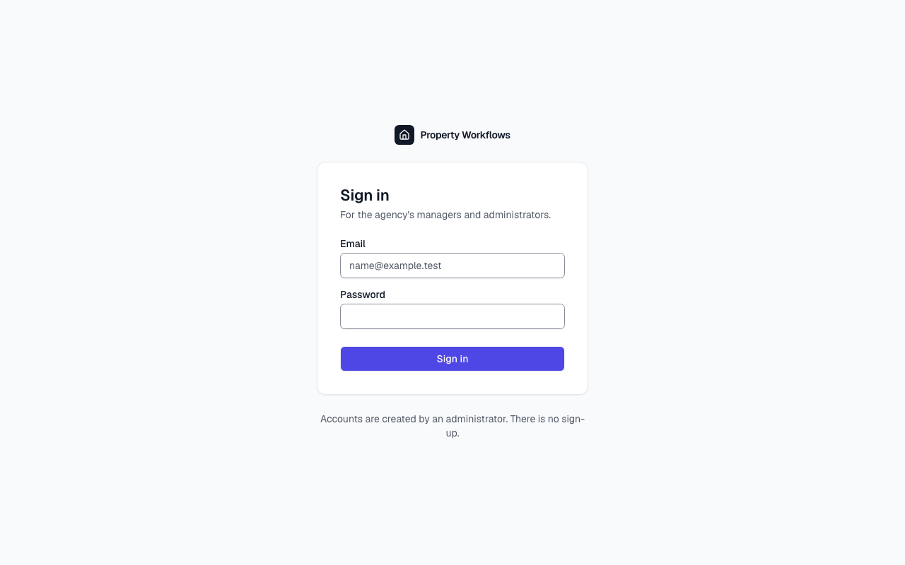

**Кроки:** ✔ Дано: a visitor who is not signed in → ✔ Коли: the visitor opens the editor of the template "Tenant move-in" by a direct link → ✔ Тоді: the visitor sees the sign-in page and no content of the template.

**Агент (claude-haiku-5-5, PASS):** На кадрі видно сторінку входу «Property Workflows» із заголовком «Sign in», полями «Email» і «Password» та кнопкою «Sign in»; вміст шаблону на кадрі не видно. Адресного рядка на кадрі немає, тому адресу /login і відсутність назв шаблону з кадру не оцінював.

**Цитати агента, звірені зі сторінкою (aria):**
- «Sign in» — є на сторінці
- «Email» — є на сторінці
- «Password» — є на сторінці
- «Sign in» — є на сторінці

**Правило:** R6: перевірки, агент і цитати збігаються

**Відео:** `test-results/artifacts/editor-access-AC-EDITOR-09-2033a-ку-входу-без-вмісту-шаблону-chromium/video.webm` · **траса:** `test-results/artifacts/editor-access-AC-EDITOR-09-2033a-ку-входу-без-вмісту-шаблону-chromium/trace.zip` (не в git)

**Рішення PM:** ☐ приймаю · ☐ відхилення від вимог (issue «Відхилення від вимог: AC-EDITOR-09 — …») · @login: ____

## AC-EDITOR-18 — PASS

**Тест:** AC-EDITOR-18: адміністратор A відкриває версії нового шаблону «Repair» — «No versions yet. Save the template to create version 1.» і без порожньої таблиці

**Критерій** (requirements/20-edit-template-version-control.md):

> AC-EDITOR-18: Given administrator A and the new template "Repair" that has never been saved as a version. When A opens the list of versions of "Repair". Then A sees the message "No versions yet. Save the template to create version 1." and no empty table.

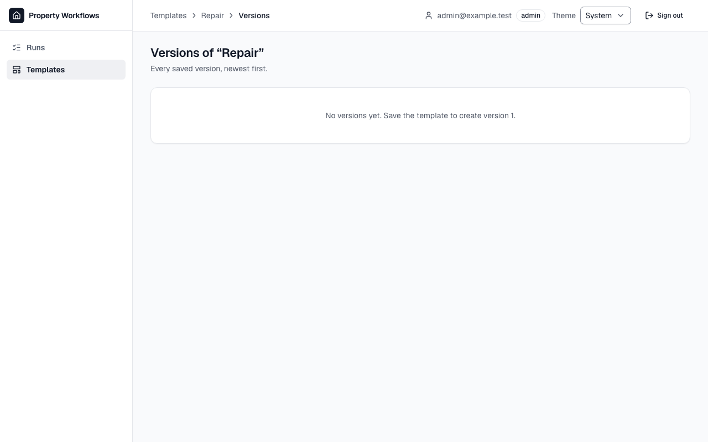

**Кроки:** ✔ Дано: administrator A and the new template "Repair" that has never been saved as a version → ✔ Коли: A opens the list of versions of "Repair" → ✔ Тоді: A sees the message "No versions yet. Save the template to create version 1." and no empty table.

**Агент (claude-haiku-5-5, PASS):** На кадрі видно заголовок «Versions of “Repair”» і одну картку з текстом «No versions yet. Save the template to create version 1.», що збігається з критерієм посимвольно. Таблиці з заголовками на кадрі не видно, але частину «no empty table» за правилами не оцінюю.

**Цитати агента, звірені зі сторінкою (aria):**
- «No versions yet. Save the template to create version 1.» — є на сторінці

**Правило:** R6: перевірки, агент і цитати збігаються

**Відео:** `test-results/artifacts/template-versions-адмініст-27669-1-»-і-без-порожньої-таблиці-chromium/video.webm` · **траса:** `test-results/artifacts/template-versions-адмініст-27669-1-»-і-без-порожньої-таблиці-chromium/trace.zip` (не в git)

**Рішення PM:** ☐ приймаю · ☐ відхилення від вимог (issue «Відхилення від вимог: AC-EDITOR-18 — …») · @login: ____

## AC-VENDOR-01 — NEEDS-HUMAN

**Тест:** AC-VENDOR-01: менеджер A запускає «Tenant move-in» для «Apartment 12, move-in» з V на задачах 3 і 4 — задачі 3 і 4 за V, 1, 2 і 5 за A

**Критерій** (requirements/39-assign-vendor-own-tasks.md):

> AC-VENDOR-01: Given manager A, vendor V and the template "Tenant move-in" with 5 tasks. When A launches the template for the case "Apartment 12, move-in" and assigns V as the assignee of tasks 3 and 4. Then tasks 3 and 4 have V as the assignee, and tasks 1, 2 and 5 have A.

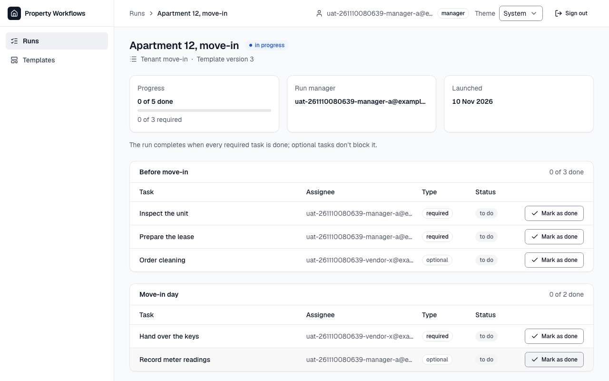

**Кроки:** ✔ Дано: manager A, vendor V and the template "Tenant move-in" with 5 tasks → ✔ Коли: A launches the template for the case "Apartment 12, move-in" and assigns V as the assignee of tasks 3 and 4 → ✔ Тоді: tasks 3 and 4 have V as the assignee, and tasks 1, 2 and 5 have A.

**Агент (claude-sonnet-5-5, NEEDS-HUMAN):** На кадрі п'ять завдань: «Order cleaning» (3-тє) і «Hand over the keys» (4-те) мають виконавця з префіксом vendor-x, а «Inspect the unit», «Prepare the lease» і «Record meter readings» — з префіксом manager-a. Адреси обрізані, тому повного збігу з критерієм підтвердити не можна, і вердикт NEEDS-HUMAN.

Haiku сказав NEEDS-HUMAN, тож розбір повторив Sonnet; рішення агента — за Sonnet.

**Агент бачить вади:**
- Адреси в колонці Assignee обрізані трикрапкою (…), тому повну адресу з критерію (…@example.test) на кадрі посимвольно звірити неможливо.
- Вимога «Не з кадрів» (порядок завдань) не оцінювалась.

**Розбір розробника (не рішення):** агент сумнівається лише через обрізані адреси на кадрі: колонка «Assignee» має CSS `truncate`, а синтетичні адреси прогону довгі (38 символів). Детерміновані перевірки звіряють повний текст DOM, а не картинку: `cellTexts("task-assignee")` дорівнює `[A, A, X, X, A]` з повними адресами (`tests/e2e/vendor-access.spec.ts`, крок «Тоді»). Вендор у цьому AC — свіжий `uat-…-vendor-x`, щоб не чіпати «Дано» V для AC-VENDOR-03…07. Повні адреси видно у відео й трасі (DOM-знімок).

**Правило:** R3: перевірки пройшли, агент не погоджується — вирішує людина

**Відео:** `test-results/artifacts/vendor-access-менеджер-A-A-bba21-ачі-3-і-4-за-V-1-2-і-5-за-A-chromium/video.webm` · **траса:** `test-results/artifacts/vendor-access-менеджер-A-A-bba21-ачі-3-і-4-за-V-1-2-і-5-за-A-chromium/trace.zip` (не в git)

**Рішення PM:** ☐ приймаю · ☐ відхилення від вимог (issue «Відхилення від вимог: AC-VENDOR-01 — …») · @login: ____

## AC-VENDOR-02 — NEEDS-HUMAN

**Тест:** AC-VENDOR-02: менеджер A у виборі виконавця бачить email B, адміністратора й V, без імен, ролей та інших даних профілю

**Критерій** (requirements/39-assign-vendor-own-tasks.md):

> AC-VENDOR-02: Given managers A and B, an administrator and vendor V, and A launching a template. When A opens the assignee picker. Then A sees the emails of B, of the administrator and of V, and no names, roles or other profile data.

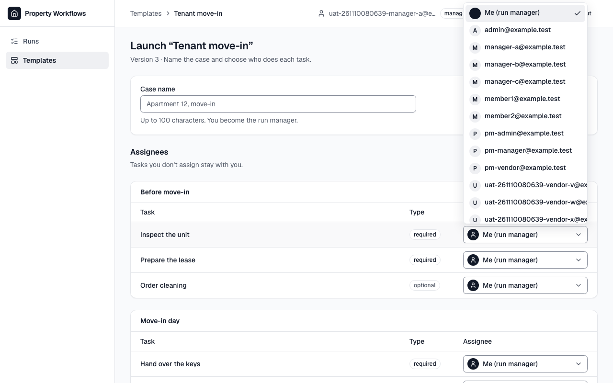

**Кроки:** ✔ Дано: managers A and B, an administrator and vendor V, and A launching a template → ✔ Коли: A opens the assignee picker → ✔ Тоді: A sees the emails of B, of the administrator and of V, and no names, roles or other profile data.

**Агент (claude-sonnet-5-5, NEEDS-HUMAN):** На кадрі відкритий список виконавців: «Me (run manager)», admin@example.test, manager-b@example.test та інші адреси. Адреса вендора X обрізана на «@ex», а список обрізаний знизу, тому відсутність імен і ролей та точний збіг адреси вендора підтвердити не вдалося.

Haiku сказав NEEDS-HUMAN, тож розбір повторив Sonnet; рішення агента — за Sonnet.

**Агент бачить вади:**
- Адреса вендора обрізана праворуч: видно лише «uat-261110080639-vendor-x@ex», домен не видно, тому точний збіг з uat-261110080639-vendor-x@example.test перевірити неможливо.
- Випадний список обрізаний знизу (останній рядок видно частково), тому не видно, чи є нижче інші записи з іменами чи ролями.
- Біля кожного запису є кружечок з літерою (A, M, P, U); це, імовірно, ініціал адреси, але це не підтверджено.

**Цитати агента, звірені зі сторінкою (aria):**
- «manager-b@example.test» — є на сторінці
- «admin@example.test» — є на сторінці

**Розбір розробника (не рішення):** адреси вендорів обрізано візуально (ширина списку дорівнює ширині поля вибору). Перевірка «Тоді» читає повний текст кожної опції: серед них `manager-b@example.test`, `admin@example.test` і повна адреса V, а кожна опція — або «Me (run manager)», або email (регулярний вираз), без імен і ролей. Інші адреси в списку — решта користувачів продакшну з ролями manager/admin/vendor; критерій не вимагає, щоб інших не було. Обрізання довгих email у списку — кандидат на покращення UX (окрема задача, якщо PM вирішить).

**Правило:** R3: перевірки пройшли, агент не погоджується — вирішує людина

**Відео:** `test-results/artifacts/vendor-access-менеджер-A-A-e6fc6-олей-та-інших-даних-профілю-chromium/video.webm` · **траса:** `test-results/artifacts/vendor-access-менеджер-A-A-e6fc6-олей-та-інших-даних-профілю-chromium/trace.zip` (не в git)

**Рішення PM:** ☐ приймаю · ☐ відхилення від вимог (issue «Відхилення від вимог: AC-VENDOR-02 — …») · @login: ____

## AC-VENDOR-03 — PASS

**Тест:** AC-VENDOR-03: вендор V бачить лише «Apartment 12, move-in» зі статусом рану й «Your tasks: 0 of 2 done», без «Apartment 14, repair»

**Критерій** (requirements/39-assign-vendor-own-tasks.md):

> AC-VENDOR-03: Given vendor V who is the assignee of 2 tasks in the run "Apartment 12, move-in" and of no task in the run "Apartment 14, repair". When V opens the list of runs. Then V sees only the run "Apartment 12, move-in" with its run status and "Your tasks: 0 of 2 done", and does not see "Apartment 14, repair".

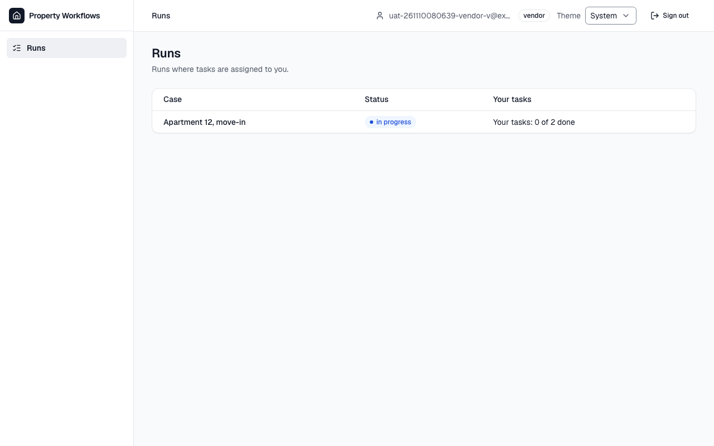

**Кроки:** ✔ Дано: vendor V who is the assignee of 2 tasks in the run "Apartment 12, move-in" and of no task in the run "Apartment 14, repair" → ✔ Коли: V opens the list of runs → ✔ Тоді: V sees only the run "Apartment 12, move-in" with its run status and "Your tasks: 0 of 2 done", and does not see "Apartment 14, repair".

**Агент (claude-haiku-5-5, PASS):** На кадрі сторінки «Runs» видно один рядок таблиці: «Apartment 12, move-in», статус «in progress», «Your tasks: 0 of 2 done». Рядка «Apartment 14, repair» на кадрі немає, але ця частина з розділу «Не з кадрів», тому її не оцінюю.

**Цитати агента, звірені зі сторінкою (aria):**
- «Apartment 12, move-in» — є на сторінці
- «in progress» — є на сторінці
- «Your tasks: 0 of 2 done» — є на сторінці

**Правило:** R6: перевірки, агент і цитати збігаються

**Відео:** `test-results/artifacts/vendor-access-вендор-V-AC--9ee5d-»-без-«Apartment-14-repair»-chromium/video.webm` · **траса:** `test-results/artifacts/vendor-access-вендор-V-AC--9ee5d-»-без-«Apartment-14-repair»-chromium/trace.zip` (не в git)

**Рішення PM:** ☐ приймаю · ☐ відхилення від вимог (issue «Відхилення від вимог: AC-VENDOR-03 — …») · @login: ____

## AC-VENDOR-04 — PASS

**Тест:** AC-VENDOR-04: вендор V у рані «Apartment 12, move-in» бачить рівно задачі 3 і 4 з назвою, секцією, позначкою й статусом — без задач 1, 2, 5, email інших і прогресу рану

**Критерій** (requirements/39-assign-vendor-own-tasks.md):

> AC-VENDOR-04: Given vendor V who is the assignee of tasks 3 and 4 in the run "Apartment 12, move-in" (5 tasks). When V opens this run. Then V sees exactly tasks 3 and 4, each with its name, its section, the mark "required" or "optional" and its status, and does not see tasks 1, 2 and 5, the emails of other users or the progress of the whole run.

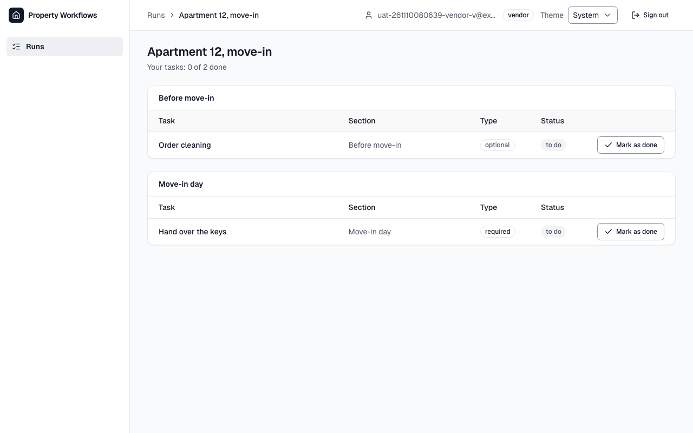

**Кроки:** ✔ Дано: vendor V who is the assignee of tasks 3 and 4 in the run "Apartment 12, move-in" (5 tasks) → ✔ Коли: V opens this run → ✔ Тоді: V sees exactly tasks 3 and 4, each with its name, its section, the mark "required" or "optional" and its status, and does not see tasks 1, 2 and 5, the emails of other users or the progress of the whole run.

**Агент (claude-haiku-5-5, PASS):** На кадрі видно рівно два рядки завдань: «Order cleaning» (секція «Before move-in», тип «optional») і «Hand over the keys» (секція «Move-in day», тип «required»), обидва зі статусом «to do». Сторінка не прокручена, нижче рядків порожньо, тож інших завдань на екрані немає. Заголовок «Your tasks: 0 of 2 done» стосується лише завдань V, а не всього прогону; перевірки на відсутність email інших користувачів і прогресу всього прогону — поза межами кадрів.

**Цитати агента, звірені зі сторінкою (aria):**
- «Order cleaning» — є на сторінці
- «Hand over the keys» — є на сторінці
- «Before move-in» — є на сторінці
- «Move-in day» — є на сторінці
- «optional» — є на сторінці
- «required» — є на сторінці
- «to do» — є на сторінці

**Правило:** R6: перевірки, агент і цитати збігаються

**Відео:** `test-results/artifacts/vendor-access-вендор-V-AC--ece6a-email-інших-і-прогресу-рану-chromium/video.webm` · **траса:** `test-results/artifacts/vendor-access-вендор-V-AC--ece6a-email-інших-і-прогресу-рану-chromium/trace.zip` (не в git)

**Рішення PM:** ☐ приймаю · ☐ відхилення від вимог (issue «Відхилення від вимог: AC-VENDOR-04 — …») · @login: ____

## AC-VENDOR-05 — PASS

**Тест:** AC-VENDOR-05: вендор V позначає задачу 3 — вона «done», і V бачить «Your tasks: 1 of 2 done»

**Критерій** (requirements/39-assign-vendor-own-tasks.md):

> AC-VENDOR-05: Given vendor V who is the assignee of task 3 with status "to do", which is not the last required task of the run "Apartment 12, move-in". When V marks task 3 as done. Then task 3 has status "done", and V sees "Your tasks: 1 of 2 done".

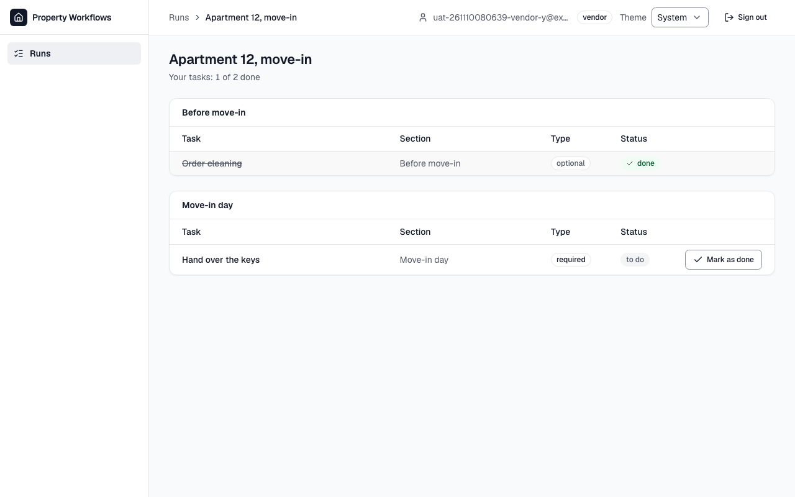

**Кроки:** ✔ Дано: vendor V who is the assignee of task 3 with status "to do", which is not the last required task of the run "Apartment 12, move-in" → ✔ Коли: V marks task 3 as done → ✔ Тоді: task 3 has status "done", and V sees "Your tasks: 1 of 2 done". → ✔ Менеджер рану A бачить задачу 3 «done» і прогрес «1 of 5 done»

**Агент (claude-haiku-5-5, PASS):** На кадрі в таблиці «Before move-in» рядок «Order cleaning» перекреслений і має статус «done» з галочкою. Над таблицями написано «Your tasks: 1 of 2 done», що збігається з критерієм посимвольно. Номер завдання «3» на кадрі не показаний, тож зіставлення з task 3 спирається на назву «Order cleaning», яку вказав PM у переліку видимих частин.

**Цитати агента, звірені зі сторінкою (aria):**
- «Order cleaning» — є на сторінці
- «done» — є на сторінці
- «Your tasks: 1 of 2 done» — є на сторінці

**Правило:** R6: перевірки, агент і цитати збігаються

**Відео:** `test-results/artifacts/vendor-access-вендор-V-поз-f8e61-ть-«Your-tasks-1-of-2-done»-chromium/video.webm` · **траса:** `test-results/artifacts/vendor-access-вендор-V-поз-f8e61-ть-«Your-tasks-1-of-2-done»-chromium/trace.zip` (не в git)

**Рішення PM:** ☐ приймаю · ☐ відхилення від вимог (issue «Відхилення від вимог: AC-VENDOR-05 — …») · @login: ____

## AC-VENDOR-06 — PASS

**Тест:** AC-VENDOR-06: вендор V за прямим посиланням на «Apartment 14, repair» бачить «Run not found» і жодної задачі рану

**Критерій** (requirements/39-assign-vendor-own-tasks.md):

> AC-VENDOR-06: Given the run "Apartment 14, repair" in which vendor V has no task. When V opens the page of this run by a direct link. Then V sees the message "Run not found" and none of the tasks of the run.

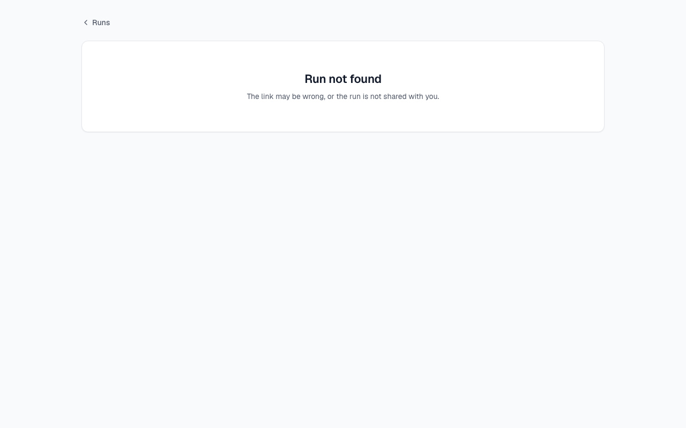

**Кроки:** ✔ Дано: the run "Apartment 14, repair" in which vendor V has no task → ✔ Коли: V opens the page of this run by a direct link → ✔ Тоді: V sees the message "Run not found" and none of the tasks of the run.

**Агент (claude-haiku-5-5, PASS):** На кадрі видно картку з великим заголовком «Run not found» і підзаголовком «The link may be wrong, or the run is not shared with you.», посилання «Runs» вгорі. Жодних рядків завдань на екрані немає. Частина «Тоді» про відсутність завдань і назви кейсу не з кадрів, тому не оцінювалась.

**Цитати агента, звірені зі сторінкою (aria):**
- «Run not found» — є на сторінці

**Правило:** R6: перевірки, агент і цитати збігаються

**Відео:** `test-results/artifacts/vendor-access-вендор-V-AC--be3d3-found»-і-жодної-задачі-рану-chromium/video.webm` · **траса:** `test-results/artifacts/vendor-access-вендор-V-AC--be3d3-found»-і-жодної-задачі-рану-chromium/trace.zip` (не в git)

**Рішення PM:** ☐ приймаю · ☐ відхилення від вимог (issue «Відхилення від вимог: AC-VENDOR-06 — …») · @login: ____

## AC-VENDOR-07 — PASS

**Тест:** AC-VENDOR-07: вендор V позначає задачу 1 менеджера A напряму, оминаючи сторінки, — задача 1 лишається «to do»

**Критерій** (requirements/39-assign-vendor-own-tasks.md):

> AC-VENDOR-07: Given the run "Apartment 12, move-in" in which task 1 is assigned to manager A and tasks 3 and 4 to vendor V. When V tries to mark task 1 as done directly, bypassing the pages of the application. Then task 1 stays "to do".

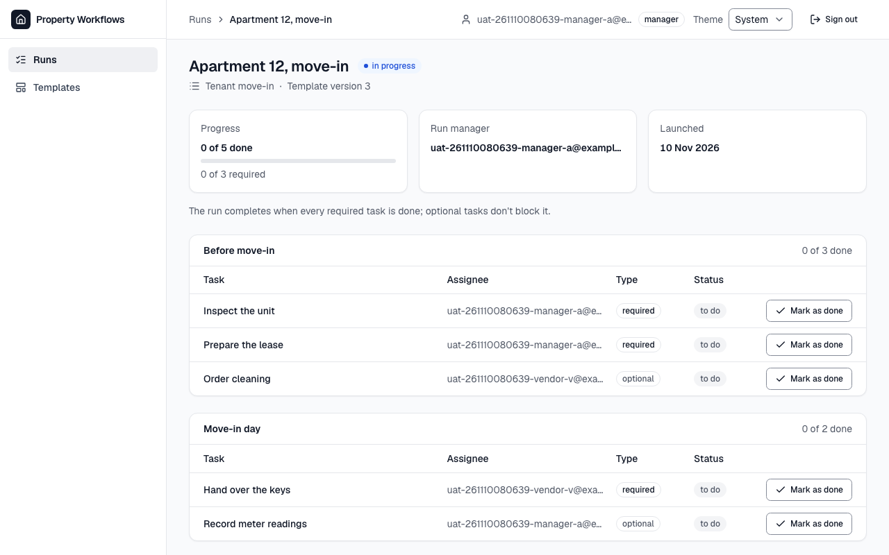

**Кроки:** ✔ Дано: the run "Apartment 12, move-in" in which task 1 is assigned to manager A and tasks 3 and 4 to vendor V → ✔ Коли: V tries to mark task 1 as done directly, bypassing the pages of the application → ✔ Тоді: task 1 stays "to do".

**Агент (claude-haiku-5-5, PASS):** На кадрі сторінка запуску «Apartment 12, move-in», у шапці видно користувача manager-a. У таблиці «Before move-in» рядок «Inspect the unit» (виконавець uat-…-manager-a@e…) має статус «to do», кнопка «Mark as done» поруч. Частина «Тоді» підтверджена; відмову NOT_ALLOWED і стан БД я не оцінював, бо це поза кадрами.

**Цитати агента, звірені зі сторінкою (aria):**
- «Inspect the unit» — є на сторінці
- «to do» — є на сторінці

**Правило:** R6: перевірки, агент і цитати збігаються

**Відео:** `test-results/artifacts/vendor-access-вендор-V-AC--d3393--задача-1-лишається-«to-do»-chromium/video.webm` · **траса:** `test-results/artifacts/vendor-access-вендор-V-AC--d3393--задача-1-лишається-«to-do»-chromium/trace.zip` (не в git)

**Рішення PM:** ☐ приймаю · ☐ відхилення від вимог (issue «Відхилення від вимог: AC-VENDOR-07 — …») · @login: ____

## AC-VENDOR-08 — PASS

**Тест:** AC-VENDOR-08: вендор V за прямим посиланням на список шаблонів бачить «Not enough rights» і жодного шаблону

**Критерій** (requirements/39-assign-vendor-own-tasks.md):

> AC-VENDOR-08: Given vendor V signed in. When V opens the list of templates by a direct link. Then V sees the message "Not enough rights" and no template.

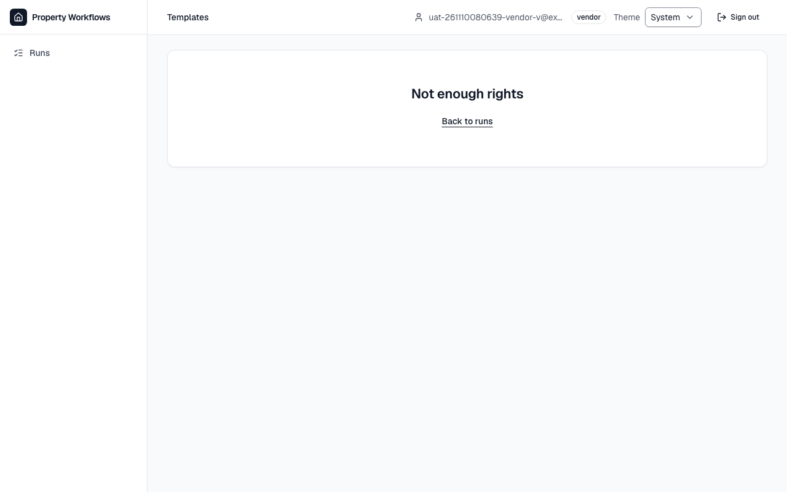

**Кроки:** ✔ Дано: vendor V signed in → ✔ Коли: V opens the list of templates by a direct link → ✔ Тоді: V sees the message "Not enough rights" and no template.

**Агент (claude-haiku-5-5, PASS):** На кадрі /templates видно великий заголовок «Not enough rights» з посиланням «Back to runs», таблиці шаблонів немає. Текст збігається з критерієм посимвольно, включно з регістром. Частина «no template» — не з кадрів, тому не оцінювалась.

**Цитати агента, звірені зі сторінкою (aria):**
- «Not enough rights» — є на сторінці

**Правило:** R6: перевірки, агент і цитати збігаються

**Відео:** `test-results/artifacts/vendor-access-вендор-V-AC--f5bad-h-rights»-і-жодного-шаблону-chromium/video.webm` · **траса:** `test-results/artifacts/vendor-access-вендор-V-AC--f5bad-h-rights»-і-жодного-шаблону-chromium/trace.zip` (не в git)

**Рішення PM:** ☐ приймаю · ☐ відхилення від вимог (issue «Відхилення від вимог: AC-VENDOR-08 — …») · @login: ____

## AC-VENDOR-09 — PASS

**Тест:** AC-VENDOR-09: вендор V запускає «Tenant move-in» напряму, оминаючи сторінки, — рану не створено, список ранів не змінився

**Критерій** (requirements/39-assign-vendor-own-tasks.md):

> AC-VENDOR-09: Given vendor V signed in and the template "Tenant move-in" with current version 1. When V tries to launch this template directly, bypassing the pages of the application. Then no run is created, and the list of runs does not change.

**Кроки:** ✔ Дано: vendor V signed in and the template "Tenant move-in" with current version 1 → ✔ Коли: V tries to launch this template directly, bypassing the pages of the application → ✔ Тоді: no run is created, and the list of runs does not change.

**Агент (claude-haiku-5-5, PASS):** На кадрі сторінка «Runs» з однією строкою: «Apartment 12, move-in», статус «in progress», «Your tasks: 0 of 2 done». Інших рядків у списку немає. Порівняння з «as before» на одному кадрі перевірити не можна, бо стан до запуску не знімався; тут зафіксовано лише стан у момент «Тоді». Відмову NOT_ALLOWED і відсутність «Apartment 15, move-in» у базі перевірити з кадрів не можна, це поза оцінкою.

**Цитати агента, звірені зі сторінкою (aria):**
- «Apartment 12, move-in» — є на сторінці

**Правило:** R6: перевірки, агент і цитати збігаються

**Відео:** `test-results/artifacts/vendor-access-вендор-V-AC--055b5-но-список-ранів-не-змінився-chromium/video.webm` · **траса:** `test-results/artifacts/vendor-access-вендор-V-AC--055b5-но-список-ранів-не-змінився-chromium/trace.zip` (не в git)

**Рішення PM:** ☐ приймаю · ☐ відхилення від вимог (issue «Відхилення від вимог: AC-VENDOR-09 — …») · @login: ____

## AC-VENDOR-10 — PASS

**Тест:** AC-VENDOR-10: вендор V без жодної задачі бачить «No tasks assigned to you yet.» і жодної порожньої таблиці

**Критерій** (requirements/39-assign-vendor-own-tasks.md):

> AC-VENDOR-10: Given vendor V to whom no task is assigned. When V opens the list of runs. Then V sees the message "No tasks assigned to you yet." and no empty table.

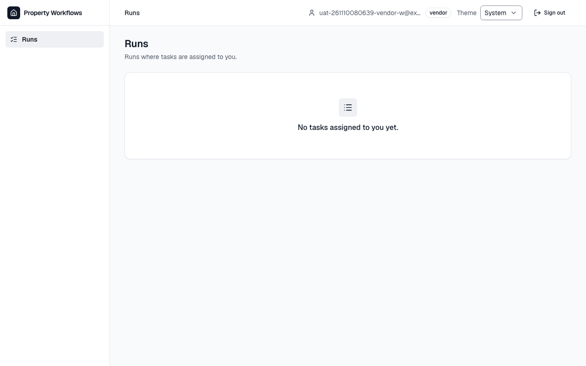

**Кроки:** ✔ Дано: vendor V to whom no task is assigned → ✔ Коли: V opens the list of runs → ✔ Тоді: V sees the message "No tasks assigned to you yet." and no empty table.

**Агент (claude-haiku-5-5, PASS):** На кадрі frame-then-1.png (сторінка «Runs») видно напис «No tasks assigned to you yet.», він збігається з критерієм посимвольно. Частина «no table element on the page» належить до розділу «Не з кадрів», тому я її не оцінював.

**Цитати агента, звірені зі сторінкою (aria):**
- «No tasks assigned to you yet.» — є на сторінці

**Правило:** R6: перевірки, агент і цитати збігаються

**Відео:** `test-results/artifacts/vendor-access-вендор-без-з-429c3--і-жодної-порожньої-таблиці-chromium/video.webm` · **траса:** `test-results/artifacts/vendor-access-вендор-без-з-429c3--і-жодної-порожньої-таблиці-chromium/trace.zip` (не в git)

**Рішення PM:** ☐ приймаю · ☐ відхилення від вимог (issue «Відхилення від вимог: AC-VENDOR-10 — …») · @login: ____

## Як читати підсумок

- **PASS** — автоматичні перевірки пройшли, агент-рецензент погодився з кадром, а кожну його цитату знайдено на сторінці.
- **FAIL** — впала автоматична перевірка. Агент цього не перекриває: невидимі вади (буфер обміну, база) він на кадрі не побачить.
- **NEEDS-HUMAN** — перевірки зелені, але агент не погодився або його цитати немає на сторінці. Часто це слабкий тест або розбіжність між текстом AC і тестом — питання до PM, а не обов'язково вада продукту.

Правила: R1: перевірка впала — FAIL завжди, агент не перекриває; R2: немає вердикту агента або кадру; R3: перевірки пройшли, агент не погоджується — вирішує людина; R4: цитати агента немає на сторінці (aria) — не підтверджено; R5: помилка сторінки або 5xx під час сценарію; R6: перевірки, агент і цитати збігаються.
