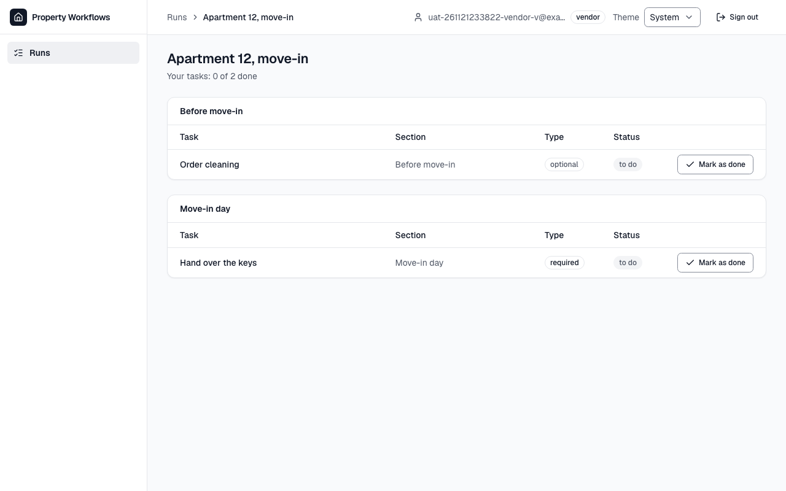

# Звіт UAT — 22.11.2026

- **Застосунок:** https://property-workflows.vercel.app (/api/health: коміт `83fa14b`)
- **Код тестів:** `task/uat-document-parsing` @ `091b4f9`
- **Прогін:** 22.11.2026, 01:38 (Київ), Playwright 30.8 с; AC: 0 — PASS 0, FAIL 0, NEEDS-HUMAN 0; негативних контролів: 1
- **Рецензент:** `claude-haiku-5-5`; суперечки → `claude-sonnet-5-5`. Разом за розбір: $0.0019 (ціни API; за підпискою — у межах ліміту плану)
- **Прибирання:** синтетичних uat-*@example.test видалено 5, лишилось 0, їхніх рядків, що лишились: 0
- **Відео й траси:** не в git — `test-results/` локально або артефакт CI; трасу відкриває `npx playwright show-trace <trace.zip>`

| AC | Перевірки | Агент | Підсумок | Чому | Playwright | Розбір |
|---|---|---|---|---|---|---|
| NC-3 (AC-DOCAI-14) | впали | Haiku: PASS | **FAIL** | R1: перевірка впала — FAIL завжди, агент не перекриває | 10.2 с | $0.0019, 6.5 с |

## NC-3 — негативний контроль для AC-DOCAI-14 — FAIL

**Тест:** NC-3 (AC-DOCAI-14, навмисно хибне очікування в тесті: вендор бачить блок «Parse a document»)

**Критерій** (requirements/59-parse-document-confirm-values.md):

> AC-DOCAI-14: Given vendor V who is the assignee of tasks 3 and 4 in the run "Apartment 12, move-in". When V opens the page of this run. Then V does not see the block "Parse a document".



**Кроки:** ✔ Дано: vendor V who is the assignee of tasks 3 and 4 in the run "Apartment 12, move-in" → ✔ Коли: V opens the page of this run → ✘ Тоді: V does not see the block "Parse a document".

**Перевірка впала:**

```
Error: expect(locator).toBeVisible() failed

Locator: getByRole('heading', { name: 'Parse a document' })
Expected: visible
Timeout: 5000ms
Error: element(s) not found

Call log:
```

**Агент (claude-haiku-5-5, PASS):** На кадрі видно повну сторінку запуску «Apartment 12, move-in» з роллю «vendor» у шапці, з двома блоками завдань («Before move-in» і «Move-in day»). Блоку «Parse a document» на сторінці немає, а нижня частина екрана порожня, тож кадр не обрізаний.

**Цитати агента, звірені зі сторінкою (aria):**
- «Apartment 12, move-in» — є на сторінці
- «Your tasks: 0 of 2 done» — є на сторінці
- «Before move-in» — є на сторінці
- «Move-in day» — є на сторінці
- «vendor» — є на сторінці

**Правило:** R1: перевірка впала — FAIL завжди, агент не перекриває

**Відео:** `test-results/artifacts-nc/negative-controls-вендор-V-f199f-ть-блок-«Parse-a-document»--negative-controls/video.webm` · **траса:** `test-results/artifacts-nc/negative-controls-вендор-V-f199f-ть-блок-«Parse-a-document»--negative-controls/trace.zip` (не в git)

_Негативний контроль: навмисно хибне очікування. Очікуваний підсумок — FAIL або NEEDS-HUMAN, не PASS._

## Як читати підсумок

- **PASS** — автоматичні перевірки пройшли, агент-рецензент погодився з кадром, а кожну його цитату знайдено на сторінці.
- **FAIL** — впала автоматична перевірка. Агент цього не перекриває: невидимі вади (буфер обміну, база) він на кадрі не побачить.
- **NEEDS-HUMAN** — перевірки зелені, але агент не погодився або його цитати немає на сторінці. Часто це слабкий тест або розбіжність між текстом AC і тестом — питання до PM, а не обов'язково вада продукту.

Правила: R1: перевірка впала — FAIL завжди, агент не перекриває; R2: немає вердикту агента або кадру; R3: перевірки пройшли, агент не погоджується — вирішує людина; R4: цитати агента немає на сторінці (aria) — не підтверджено; R5: помилка сторінки або 5xx під час сценарію; R6: перевірки, агент і цитати збігаються.
