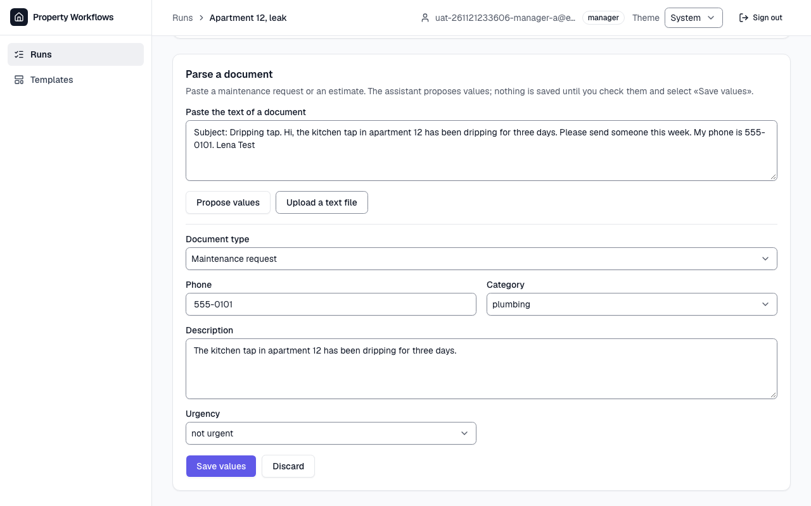
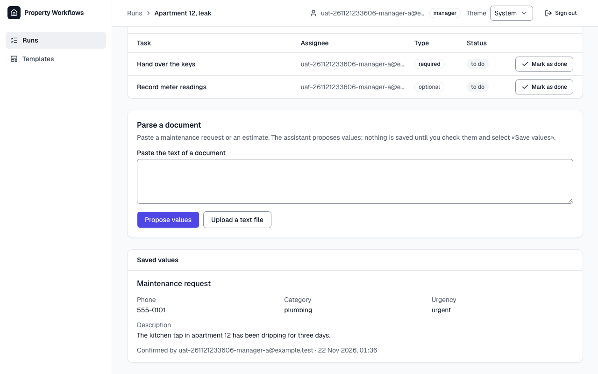
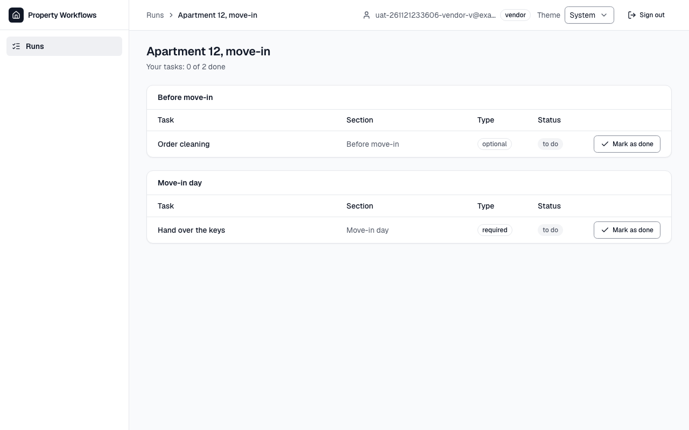

# Звіт UAT — 22.11.2026

- **Застосунок:** https://property-workflows.vercel.app (/api/health: коміт `83fa14b`)
- **Код тестів:** `task/uat-document-parsing` @ `e489e30`
- **Прогін:** 22.11.2026, 01:36 (Київ), Playwright 69.9 с; AC: 4 — PASS 4, FAIL 0, NEEDS-HUMAN 0
- **Рецензент:** `claude-haiku-5-5`; суперечки → `claude-sonnet-5-5`. Разом за розбір: $0.0091 (ціни API; за підпискою — у межах ліміту плану)
- **Прибирання:** синтетичних uat-*@example.test видалено 5, лишилось 0, їхніх рядків, що лишились: 0
- **Відео й траси:** не в git — `test-results/` локально або артефакт CI; трасу відкриває `npx playwright show-trace <trace.zip>`

| AC | Перевірки | Агент | Підсумок | Чому | Playwright | Розбір |
|---|---|---|---|---|---|---|
| AC-DOCAI-01 | пройшли | Haiku: PASS | **PASS** | R6: перевірки, агент і цитати збігаються | 14.3 с | $0.0025, 10.6 с |
| AC-DOCAI-04 | пройшли | Haiku: PASS | **PASS** | R6: перевірки, агент і цитати збігаються | 18.6 с | $0.0025, 10.3 с |
| AC-DOCAI-14 | пройшли | Haiku: PASS | **PASS** | R6: перевірки, агент і цитати збігаються | 3.1 с | $0.0019, 6.6 с |
| AC-DOCAI-16 | пройшли | Haiku: PASS | **PASS** | R6: перевірки, агент і цитати збігаються | 7.4 с | $0.0022, 10.2 с |

## AC-DOCAI-01 — PASS

**Тест:** AC-DOCAI-01: менеджер A пропонує значення для заявки про кран — Maintenance request, 555-0101, опис, plumbing, not urgent; нічого не збережено

**Критерій** (requirements/59-parse-document-confirm-values.md):

> AC-DOCAI-01: Given run manager A on the page of the run "Apartment 12, leak" and the pasted text "Subject: Dripping tap. Hi, the kitchen tap in apartment 12 has been dripping for three days. Please send someone this week. My phone is 555-0101. Lena Test". When A chooses "Propose values". Then the block shows Document type "Maintenance request", Phone "555-0101", a Description that says the kitchen tap in apartment 12 has been dripping for three days, Category "plumbing" and Urgency "not urgent", and nothing is saved yet.

**Кроки:** ✔ Дано: run manager A on the page of the run "Apartment 12, leak" and the pasted text "Subject: Dripping tap. …" → ✔ Коли: A chooses "Propose values" → ✔ Тоді: the block shows Document type "Maintenance request", Phone "555-0101", a Description that says the kitchen tap in apartment 12 has been dripping for three days, Category "plumbing" and Urgency "not urgent", and nothing is saved yet.

**Агент (claude-haiku-5-5, PASS):** На кадрі сторінки запуску «Apartment 12, leak» блок «Parse a document» показує Document type «Maintenance request», Phone «555-0101», Category «plumbing», Urgency «not urgent» і опис про кухонний кран у квартирі 12, що капає три дні — усе збігається з критерієм посимвольно. Внизу видно кнопки «Save values» і «Discard» без жодного повідомлення про збереження; відсутність збереження з кадру підтверджується лише ознакою «Saved values» не видно, тож «ще не обрано» — висновок з відсутності підтвердження.

**Цитати агента, звірені зі сторінкою (aria):**
- «Document type» — є на сторінці
- «Maintenance request» — є на сторінці
- «Phone» — є на сторінці
- «555-0101» — є на сторінці
- «Category» — є на сторінці
- «plumbing» — є на сторінці
- «Urgency» — є на сторінці
- «not urgent» — є на сторінці
- «The kitchen tap in apartment 12 has been dripping for three days.» — є на сторінці
- «Save values» — є на сторінці
- «Discard» — є на сторінці

**Правило:** R6: перевірки, агент і цитати збігаються

**Відео:** `test-results/artifacts/document-parsing-менеджер--e1caf--urgent-нічого-не-збережено-chromium/video.webm` · **траса:** `test-results/artifacts/document-parsing-менеджер--e1caf--urgent-нічого-не-збережено-chromium/trace.zip` (не в git)

**Рішення PM:** ☐ приймаю · ☐ відхилення від вимог (issue «Відхилення від вимог: AC-DOCAI-01 — …») · @login: ____

## AC-DOCAI-04 — PASS

**Тест:** AC-DOCAI-04: менеджер A змінює Urgency на «urgent» і зберігає — один запис з email A і датою й часом підтвердження

**Критерій** (requirements/59-parse-document-confirm-values.md):

> AC-DOCAI-04: Given run manager A with Document type "Maintenance request", Phone "555-0101", Category "plumbing" and Urgency "not urgent" proposed in the block. When A changes Urgency to "urgent" and chooses "Save values". Then the page of the run shows one saved record with Document type "Maintenance request", Phone "555-0101", Category "plumbing" and Urgency "urgent", the email of A and the date and time of the confirmation.

**Кроки:** ✔ Дано: run manager A with Document type "Maintenance request", Phone "555-0101", Category "plumbing" and Urgency "not urgent" proposed in the block → ✔ Коли: A changes Urgency to "urgent" and chooses "Save values" → ✔ Тоді: the page of the run shows one saved record with Document type "Maintenance request", Phone "555-0101", Category "plumbing" and Urgency "urgent", the email of A and the date and time of the confirmation.

**Агент (claude-haiku-5-5, PASS):** На кадрі сторінки запуску в блоці «Saved values» видно одну картку з Maintenance request, Phone 555-0101, Category plumbing і Urgency urgent. Під карткою є напис «Confirmed by uat-261121233606-manager-a@example.test · 22 Nov 2026, 01:36», що відповідає email менеджера A і даті та часу підтвердження. Кадр повний, не в стані завантаження. Поле «Description» на картці в критерії не згадано, але це не суперечить «Тоді», тому вади не позначено.

**Цитати агента, звірені зі сторінкою (aria):**
- «Saved values» — є на сторінці
- «Maintenance request» — є на сторінці
- «Phone» — є на сторінці
- «555-0101» — є на сторінці
- «Category» — є на сторінці
- «plumbing» — є на сторінці
- «Urgency» — є на сторінці
- «urgent» — є на сторінці
- «Confirmed by uat-261121233606-manager-a@example.test · 22 Nov 2026, 01:36» — є на сторінці

**Правило:** R6: перевірки, агент і цитати збігаються

**Відео:** `test-results/artifacts/document-parsing-менеджер--029a2-датою-й-часом-підтвердження-chromium/video.webm` · **траса:** `test-results/artifacts/document-parsing-менеджер--029a2-датою-й-часом-підтвердження-chromium/trace.zip` (не в git)

**Рішення PM:** ☐ приймаю · ☐ відхилення від вимог (issue «Відхилення від вимог: AC-DOCAI-04 — …») · @login: ____

## AC-DOCAI-14 — PASS

**Тест:** AC-DOCAI-14: вендор V відкриває ран «Apartment 12, move-in», де він виконавець задач 3 і 4, — блоку «Parse a document» немає

**Критерій** (requirements/59-parse-document-confirm-values.md):

> AC-DOCAI-14: Given vendor V who is the assignee of tasks 3 and 4 in the run "Apartment 12, move-in". When V opens the page of this run. Then V does not see the block "Parse a document".

**Кроки:** ✔ Дано: vendor V who is the assignee of tasks 3 and 4 in the run "Apartment 12, move-in" → ✔ Коли: V opens the page of this run → ✔ Тоді: V does not see the block "Parse a document".

**Агент (claude-haiku-5-5, PASS):** На кадрі видно сторінку запуску «Apartment 12, move-in» із заголовком користувача vendor (badge «vendor»). Блоку «Parse a document» немає: є лише секції «Before move-in» і «Move-in day» із завданнями «Order cleaning» та «Hand over the keys». Кадр повний, без обрізання.

**Цитати агента, звірені зі сторінкою (aria):**
- «Apartment 12, move-in» — є на сторінці
- «Your tasks: 0 of 2 done» — є на сторінці
- «Before move-in» — є на сторінці
- «Move-in day» — є на сторінці

**Правило:** R6: перевірки, агент і цитати збігаються

**Відео:** `test-results/artifacts/document-parsing-вендор-V--b1ccf-ку-«Parse-a-document»-немає-chromium/video.webm` · **траса:** `test-results/artifacts/document-parsing-вендор-V--b1ccf-ку-«Parse-a-document»-немає-chromium/trace.zip` (не в git)

**Рішення PM:** ☐ приймаю · ☐ відхилення від вимог (issue «Відхилення від вимог: AC-DOCAI-14 — …») · @login: ____

## AC-DOCAI-16 — PASS

**Тест:** AC-DOCAI-16: вендор V просить значення й зберігає їх напряму, оминаючи сторінки, — жодного значення й запису, «Not enough rights»

**Критерій** (requirements/59-parse-document-confirm-values.md):

> AC-DOCAI-16: Given vendor V, or manager B who is not the run manager, in the run "Apartment 12, move-in". When they try to ask the AI for values or to save values for this run directly, bypassing the pages of the application. Then they receive no value, no record is saved, and they see the message "Not enough rights".

**Кроки:** ✔ Дано: vendor V in the run "Apartment 12, move-in" → ✔ Коли: V tries to ask the AI for values and to save values for this run directly, bypassing the pages of the application → ✔ Тоді: they receive no value, no record is saved, and they see the message "Not enough rights".

**Агент (claude-haiku-5-5, PASS):** Кадр показує повну сторінку запуску «Apartment 12, move-in» для користувача з роллю vendor: видно лише два блоки завдань («Before move-in» і «Move-in day»). Блоків «Parse a document» і «Saved values» немає, кадр не обрізаний. Частини «Тоді» про відповідь AI та відсутність запису в базі не з кадрів, тому не оцінювалися.

**Цитати агента, звірені зі сторінкою (aria):**
- «Apartment 12, move-in» — є на сторінці
- «Your tasks: 0 of 2 done» — є на сторінці
- «Before move-in» — є на сторінці
- «Move-in day» — є на сторінці

**Правило:** R6: перевірки, агент і цитати збігаються

**Відео:** `test-results/artifacts/document-parsing-вендор-V--233a5--запису-«Not-enough-rights»-chromium/video.webm` · **траса:** `test-results/artifacts/document-parsing-вендор-V--233a5--запису-«Not-enough-rights»-chromium/trace.zip` (не в git)

**Рішення PM:** ☐ приймаю · ☐ відхилення від вимог (issue «Відхилення від вимог: AC-DOCAI-16 — …») · @login: ____

## Як читати підсумок

- **PASS** — автоматичні перевірки пройшли, агент-рецензент погодився з кадром, а кожну його цитату знайдено на сторінці.
- **FAIL** — впала автоматична перевірка. Агент цього не перекриває: невидимі вади (буфер обміну, база) він на кадрі не побачить.
- **NEEDS-HUMAN** — перевірки зелені, але агент не погодився або його цитати немає на сторінці. Часто це слабкий тест або розбіжність між текстом AC і тестом — питання до PM, а не обов'язково вада продукту.

Правила: R1: перевірка впала — FAIL завжди, агент не перекриває; R2: немає вердикту агента або кадру; R3: перевірки пройшли, агент не погоджується — вирішує людина; R4: цитати агента немає на сторінці (aria) — не підтверджено; R5: помилка сторінки або 5xx під час сценарію; R6: перевірки, агент і цитати збігаються.
